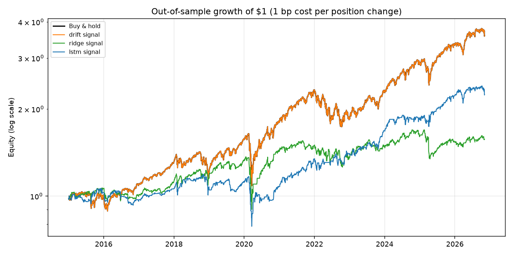
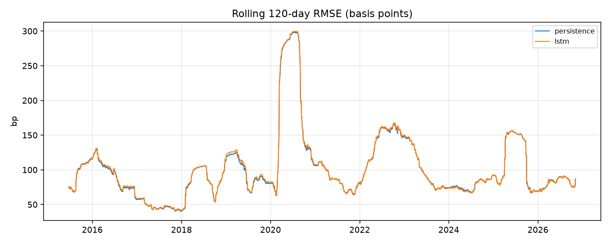
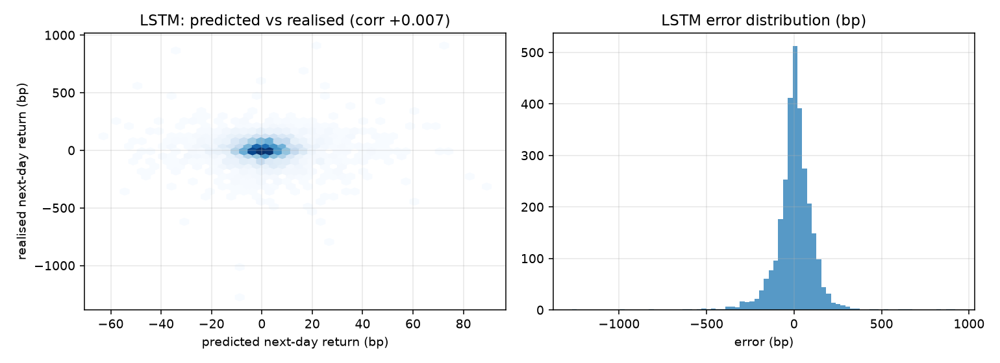

# S&P 500 — Enhanced Return Forecasting


A leakage-free rebuild of the original `Stock-Market-Prediction` notebook: does an
LSTM actually add anything over **"tomorrow = today"** on the S&P 500?

**Short answer: no — and this repository is built to show that honestly.**
Over **2,979 out-of-sample trading days** (2015-01-02 → 2026-11-05),
the LSTM's mean absolute error is **73.23 bp** of daily return against
**72.73 bp** for "tomorrow = today" — a MASE of **1.007**, i.e. 0.7%
*worse* than doing nothing. Its directional hit rate is **50.3%**, a coin
flip, and the Diebold–Mariano test cannot separate it from the naive forecast
(p = 0.127). The weird part would have been finding signal.
That is the result the dashboard reports instead of a fake accuracy number.

| model | RMSE (bp) | MAE (bp) | MASE | hit rate | DM p vs naive |
|---|---|---|---|---|---|
| persistence (naive) | 111.51 | 72.73 | 1.0000 | — | — |
| drift (train mean) | 111.44 | 72.56 | 0.9976 | 53.9% | 0.182 |
| ridge | 112.19 | 73.01 | 1.0039 | 51.2% | 0.107 |
| **LSTM** | **112.14** | **73.23** | **1.0069** | **50.3%** | **0.127** |

The only model that edges past naive is *drift* — and that is not skill: 2015–2026 was
mostly an up-market, so always predicting the training mean wins by a hair
(MASE 0.9976, p = 0.182, not significant).

## Why this exists: v1 → v2 audit

The original notebook (`notebooks/StockMarketPred.ipynb`) sets out five phases and
implements only the first — preprocessing — with a write-up that describes an LSTM
and a dashboard that are not in the repository. While rebuilding, I measured the
preprocessing it does have:

| v1 behaviour | Measured impact | v2 fix |
|---|---|---|
| IQR cap/floor applied to `Adj Close`, the prediction target | Clamped **1,346 of 23,323 rows (5.8%)** — every price from **2014‑11‑18** onward — at 2050.98, flattening the last six years of the series (max 3580.84 → 2050.98) | Never winsorise the target. Model **log returns**, which are already bounded and stationary |
| One global IQR across 93 years of a trending series | "Outliers" are mostly just the modern price regime; 5,496 zero-volume rows (1927‑12‑30 → 1949‑12‑30) treated as data | Volume is used only as a *ratio* to its own 20‑day mean, so scale and regime shift wash out |
| Redundant-column test on **price levels** | `Open/High/Low/Close` correlate ~1.00 with `Adj Close` only because all five share one exponential trend | Features are built from returns and rolling statistics, not price levels |
| `MinMaxScaler` fit on the full dataset before any split | Test-period min/max leaks into the training transform | Every scaler is fit **inside each walk-forward fold**, on training rows only |

v1 data also stops at 2020‑11‑04. This version re-fetches through the present and
records the fetch in `data/raw/spx_daily.meta.json`.

## What the pipeline does

```
fetch (Yahoo ^GSPC, 1970→today) → validate → features → walk-forward backtest → report + dashboard
```

- **Target** — next-day log return of the close. Price levels are never the label.
- **Features** (10) — trailing returns (1/5/20d), realised volatility (5/20d),
  Wilder RSI, intraday range, volume ratio, distance from the 20‑day mean, overnight gap.
- **Models** — persistence (`r̂ = 0`), drift (train mean), ridge, LSTM
  (20‑day window → 32 units → dropout → 1 output).
- **Evaluation** — expanding-window walk-forward, refit every 252 trading days,
  strictly chronological blocks. Metrics: RMSE/MAE in basis points, MASE vs naive,
  R², directional hit rate, Diebold–Mariano test, and a cost-aware equity curve.

`tests/test_features.py::test_no_lookahead` is the guard that matters: it perturbs
all data after a cutoff date and asserts that no feature at or before the cutoff moves.

## Results

Everything is measured on next-day **log returns**, never prices, and the test
window is never touched during fitting. The LSTM's forecasts also have far smaller
dispersion than realised returns (σ = 13.1 bp vs 111.4 bp, correlation 0.007): it regresses to the mean,
which is what a variance-minimising model does when there is little to learn.

Full tables, all four models, and the figures are regenerated by
`scripts/run_backtest.py` into [`reports/RESULTS.md`](reports/RESULTS.md).

Read the equity panel with care: the LSTM signal line ends above buy & hold, but a
forecast with 0.007 correlation to realised returns has no mechanism to produce that.
It is one lucky path out of many, and that is exactly the trap this repository exists
to point at.





## Quickstart

```bash
# 1. environment (Python 3.12)
uv venv .venv --python 3.12
uv pip install --python .venv/bin/python -e ".[dev]"

# 2. data + backtest (fetches from Yahoo, ~5 min because of the LSTM refits)
make data
make backtest

# 3. dashboard
make app          # http://localhost:8501

# 4. tests
make test
```

TensorFlow is only needed for the LSTM. The test suite runs without it
(`pytest` needs numpy, pandas, scikit-learn).

## Layout

```
src/spx_forecast/
  data.py      fetch, clean, validate, provenance
  features.py  causal features + sequences (the leakage surface)
  models.py    persistence, drift, ridge, LSTM — each owns its scaler
  backtest.py  expanding-window walk-forward
  evaluate.py  metrics, Diebold–Mariano, equity maths
  plots.py     figures
scripts/
  fetch_data.py    refresh data/raw/
  run_backtest.py  the full run → results/ + reports/RESULTS.md
app/streamlit_app.py   dashboard
tests/                 leakage, metric and data-validation tests
data/raw/              committed snapshot for reproducibility
results/               predictions.csv, metrics.json, figures
```

## Limitations

- One asset, one frequency. Nothing here says anything about intraday, cross-sectional
  or multi-asset forecasting, where more signal exists.
- Transaction costs are a flat 1 bp per position change; slippage and borrow are ignored.
- No hyperparameter search on the LSTM — deliberately, because tuning on the test
  window is how these projects usually fool themselves. Architecture choices are fixed
  in `config.py` and were set on training data only.
- The equity curve is a diagnostic of forecast sign, not a trading strategy. It is not
  investment advice.
- `data/raw/` is a point-in-time snapshot; `make data` refreshes it and the results
  will shift slightly with the extra days.
